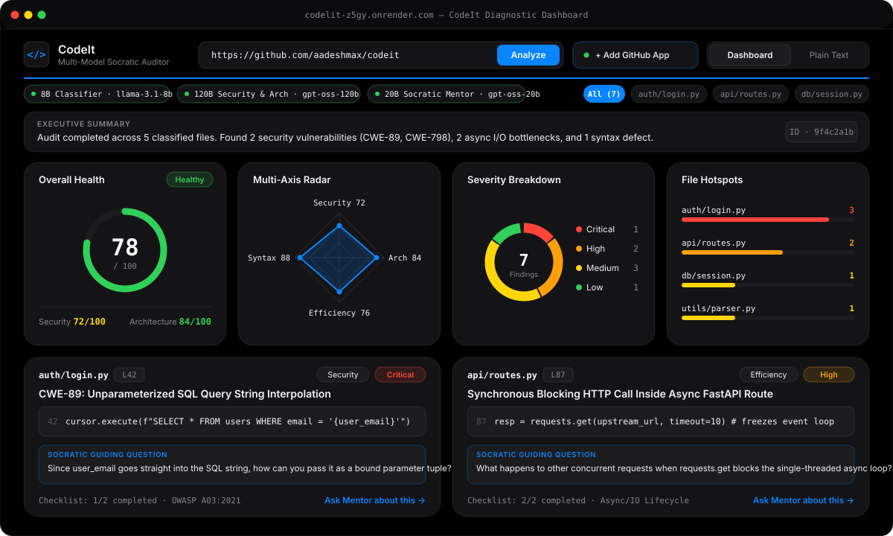
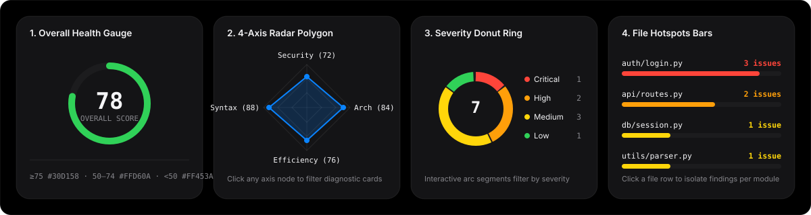
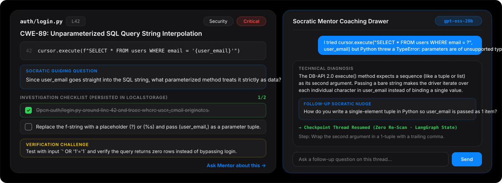
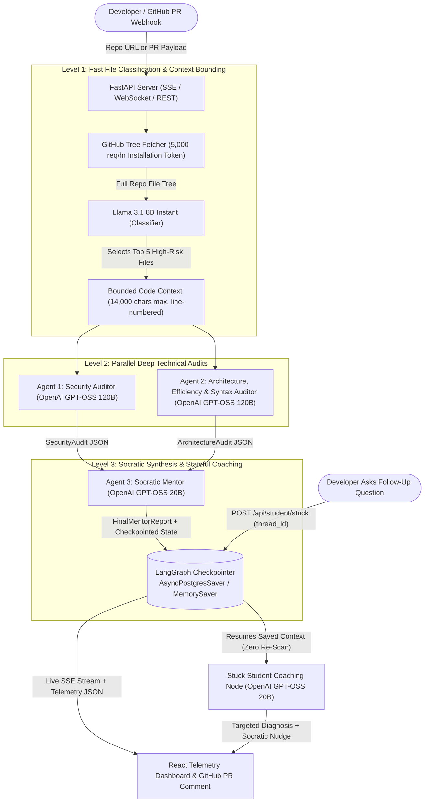
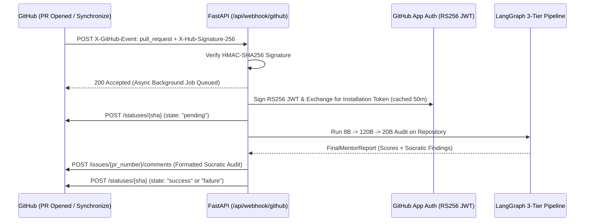

# CodeIt — Multi-Model Socratic Code Auditor & Telemetry Dashboard

CodeIt is an AI code auditing platform and GitHub App that scans repositories for **Security**, **Architecture**, **Efficiency**, and **Syntax** flaws—and coaches developers through fixing them using the **Socratic method**.

Most AI code tools do one of two things:
1. Give you a vague hint (*"Check your input validation"*), leaving you frustrated and digging through files blindly.
2. Dump a copy-paste code block, which fixes the line in 2 seconds but teaches you nothing about *why* it broke.

**CodeIt sits in the sweet spot:** it gives you **full diagnostic metadata** (exact file path, line numbers, offending snippet, CWE/OWASP reference, and production failure impact) paired with **clear, approachable Socratic guidance** (conceptual explanation, a targeted guiding question, an interactive investigation checklist, and a verification test challenge).

---

## Frontend UI & Interactive Telemetry Dashboard

Built with an Apple OLED Dark engineering aesthetic (`#000000` canvas, `#141416` Bento cards, `1px` hairline borders, SF Pro / SF Mono typography, and critically damped Framer Motion springs).



### 4 Custom Pure-SVG Bento Telemetry Charts

Instead of heavy third-party charting libraries, CodeIt renders four zero-dependency `<svg>` telemetry widgets with `tabular-nums` precision and interactive cross-filtering:



1. **Overall Health Radial Gauge (`0–100`)**
   - Displays the composite repository health score with threshold color coding (`#30D158` Healthy $\ge 75$, `#FFD60A` Warning $50\text{–}74$, `#FF453A` Critical $< 50$) alongside Security and Architecture sub-scores.
2. **4-Axis Telemetry Radar Chart**
   - Plots **Security**, **Architecture**, **Efficiency**, and **Syntax** scores on a concentric 4-axis polygon. Clicking any axis node filters the diagnostic cards below to that category.
3. **Severity Distribution Donut Ring**
   - Breaks down findings across **Critical**, **High**, **Medium**, and **Low** severities. Clicking any arc segment or legend pill isolates findings of that severity.
4. **File Hotspots Horizontal Bar Chart**
   - Ranks the repository's most affected files by issue count and highest severity. Clicking a file bar filters the dashboard to show only issues inside that file.

---

### Diagnostic Finding Cards & Live Socratic Mentor Drawer

Every finding card pairs exact diagnostic telemetry with an interactive investigation workflow. If a developer tries a fix and gets stuck, clicking **"Ask Mentor about this"** slides out the Socratic Mentor Drawer.



- **In-House Syntax-Highlighted Snippet Block:** Displays the exact offending code with line number badges (`L42`, `L87`) and a collapsible **Production Impact & Standards Reference** (`CWE-89`, `OWASP Top 10`) accordion.
- **Persistent Investigation Checklist:** Step-by-step debugging actions persisted in `localStorage` per checkpoint `thread_id`.
- **Zero-Rescan Follow-Up Coaching (`POST /api/student/stuck`):** Powered by **LangGraph Checkpointing**, follow-up questions resume the existing `thread_id` snapshot in memory or PostgreSQL—never re-fetching or re-auditing the repository.

---

## Multi-Level AI Pipeline Architecture

CodeIt orchestrates a 3-tier model hierarchy on **Groq** via **LangGraph**, matching each stage of the audit to the right model size for speed, reasoning depth, and token efficiency:



### Why 3 Model Tiers?
| Tier | Model | Role in Pipeline | Why this model? |
| :--- | :--- | :--- | :--- |
| **Level 1** | `llama-3.1-8b-instant` *(with fallback chain)* | Scans the entire repository file tree and selects the top 5 core source files to inspect | Sub-second classification keeps initial latency low and filters out `node_modules`, lockfiles, and build artifacts |
| **Level 2** | `openai/gpt-oss-120b` | Runs **two parallel audits**: Agent 1 checks Security (`CWE` / `OWASP`); Agent 2 checks Architecture, `O(N²)` complexity, blocking async I/O, and Syntax defects | 120B parameter reasoning catches subtle cross-function vulnerabilities and structural bottlenecks |
| **Level 3** | `openai/gpt-oss-20b` | Synthesizes raw audit findings into clear Socratic guidance and powers stateful follow-up mentoring | Fast structured JSON synthesis with approachable, developer-friendly coaching clues |

---

## GitHub App (`Codelitlabs`) & Automated PR Webhooks

CodeIt includes a "+ Add GitHub App" workflow right in the header so teams can install the **Codelitlabs** GitHub App (`App ID: 5523137`) on their repositories for automated pull request reviews.



---

## Tech Stack

| Layer | Technologies |
| :--- | :--- |
| **Frontend** | React 19, TypeScript 5.7, Vite 6, Framer Motion 12 (Apple spring physics), Lucide Icons, Custom Pure-SVG Telemetry Charts, Modular CSS Variables |
| **Backend API** | Python 3.11+, FastAPI, Uvicorn, Server-Sent Events (`StreamingResponse` with `: ping` heartbeats), WebSockets, `httpx` async client |
| **AI & Orchestration** | LangGraph (`StateGraph`), LangChain Groq, `AsyncPostgresSaver` / `MemorySaver` state checkpointing, Pydantic v2 structured schemas |
| **GitHub Integration** | GitHub App RS256 JWT signing (`PyJWT` + `cryptography`), HMAC-SHA256 webhook verification, Installation Token caching (5,000 req/hr rate limit) |
| **Deployment** | Render Single-Service Web Service (FastAPI serves both `/api/*` endpoints and compiled `frontend/dist` static SPA bundle) |

---

## Project Structure

```text
codeit/
├── codeit-backend/
│   ├── main.py                # FastAPI server, SSE/WS streams, GitHub webhook handler & SPA static mount
│   ├── agents.py              # Level 2 (120B Security/Arch/Syntax) & Level 3 (20B Socratic Mentor & Stuck Node)
│   ├── fetcher.py             # Level 1 (8B file classifier) & token-budgeted GitHub context fetcher
│   ├── schemas.py             # Strict Pydantic v2 models & LangGraph TypedDict state
│   ├── github_app_auth.py     # RS256 JWT generator & 50-minute installation token cache
│   └── requirements.txt       # Python dependencies
├── frontend/
│   ├── index.html             # OLED dark entry point
│   └── src/
│       ├── App.tsx            # Main dashboard layout, filters & view toggles
│       ├── hooks/
│       │   └── useAnalyzeStream.ts        # Live SSE stream client with WebSocket & REST fallbacks
│       ├── components/
│       │   ├── RepoPipelineHeader.tsx     # Search-to-header morph bar, model tier stepper & file chips
│       │   ├── AnalyticsBentoGrid.tsx     # 4-column telemetry Bento layout
│       │   ├── DiagnosticCard.tsx         # Finding card, impact accordion & persistent checklist
│       │   ├── CodeSnippetBlock.tsx       # Line-numbered syntax-highlighted code viewer
│       │   ├── SocraticMentorDrawer.tsx   # Slide-over follow-up mentor drawer (/api/student/stuck)
│       │   ├── WebhookAppModal.tsx        # GitHub App installation & webhook setup modal
│       │   └── charts/                    # Pure-SVG RadialGauge, RadarChart, SeverityDonut, FileHotspotBars
│       └── styles/
│           ├── tokens.css                 # Apple dark color, radius & typography tokens
│           └── global.css                 # Reset & tabular-nums precision rules
└── docs/
    └── assets/                # Dashboard & telemetry SVG previews
```

---

## API Reference

| Method | Endpoint | Description |
| :--- | :--- | :--- |
| `GET` | `/api/analyze/stream?repo_url=...` | **Live SSE stream** emitting real-time progress (`5%` $\rightarrow$ `100%`), `files_classified`, intermediate audit scores, and final payload |
| `WS` | `/ws/analyze` | **WebSocket stream** alternative for real-time bi-directional audit events |
| `POST` | `/api/analyze` | Synchronous JSON analysis endpoint returning `AnalyzeResponse` |
| `GET` | `/api/analyze/text?repo_url=...` | Streams a formatted plain-text / Markdown audit report |
| `POST` | `/api/student/stuck` | Resumes a `thread_id` checkpoint to provide targeted follow-up Socratic coaching without re-scanning |
| `GET` | `/api/student/checkpoint/{thread_id}` | Inspects a saved LangGraph checkpoint snapshot and chat history |
| `POST` | `/api/webhook/github` | Receives GitHub `pull_request` and `push` webhooks, verifies HMAC-SHA256, and posts PR reviews |
| `GET` | `/health` | Returns service health, active model tiers, and checkpointer backend status |

---

## Running Locally

### 1. Clone the repository
```bash
git clone https://github.com/aadeshmax/codeit.git
cd codeit
```

### 2. Configure Backend Environment Variables
Create `codeit-backend/.env`:
```env
GROQ_API_KEY=gsk_your_groq_api_key_here
GITHUB_TOKEN=ghp_optional_personal_access_token
GITHUB_APP_ID=5523137
GITHUB_WEBHOOK_SECRET=your_webhook_secret
GITHUB_APP_PRIVATE_KEY_PATH=github-app-private-key.pem
```

### 3. Build Frontend & Start Unified Server
```bash
# Build the React frontend into frontend/dist
cd frontend
npm install
npm run build

# Start FastAPI (serves both the React UI and /api endpoints on port 8000)
cd ../codeit-backend
python -m venv venv
venv\Scripts\activate   # On macOS/Linux: source venv/bin/activate
pip install -r requirements.txt
uvicorn main:app --reload --port 8000
```

Open `http://localhost:8000` in your browser to launch the dashboard.

---

## Deploying Both Frontend & Backend on Render (Single Service)

Because FastAPI mounts `frontend/dist` automatically when present, you can run the entire full-stack application on a single Render Web Service:

- **Root Directory:** *(leave blank / repo root)*
- **Build Command:**
  ```bash
  cd frontend && npm install && npm run build && cd ../codeit-backend && pip install -r requirements.txt
  ```
- **Start Command:**
  ```bash
  cd codeit-backend && uvicorn main:app --host 0.0.0.0 --port $PORT
  ```
